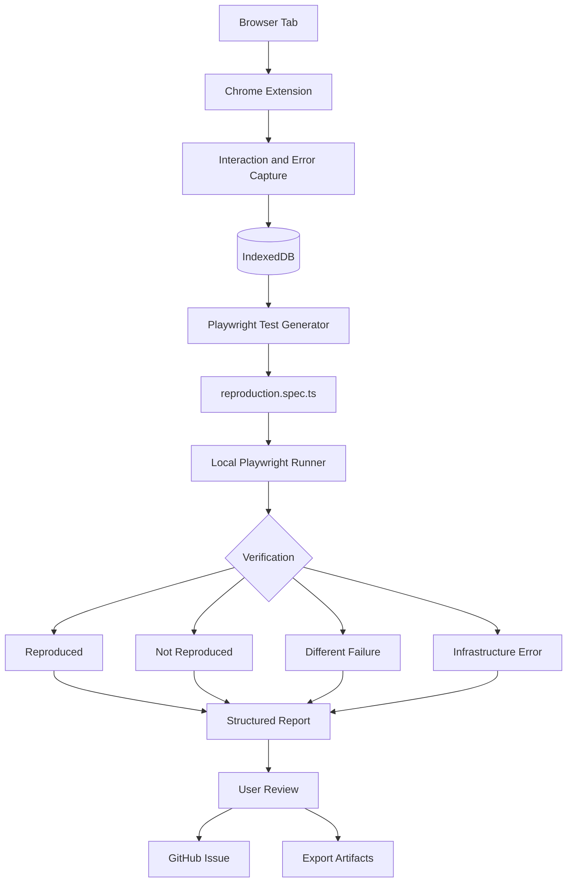

<div align="center">

# ReproFlow

### Record once. Reproduce anywhere. Fix faster.

**From "I found a bug" to "Here's the test that proves it."**

A local-first Chrome extension that transforms browser bugs into **executable, verified Playwright tests**, complete with debugging evidence and GitHub issue integration.

**[Overview](#overview) · [Features](#features) · [How It Works](#how-it-works) · [Quick Start](#quick-start) · [Architecture](#architecture) · [Roadmap](#roadmap)**

**Version 0.1.0 | Early Development | Chromium Only**

</div>

---

## Overview

### Stop describing bugs. Start reproducing them.

ReproFlow is an open-source developer tool that bridges the gap between discovering a browser bug and fixing it.

Instead of manually documenting reproduction steps, collecting screenshots, and explaining unexpected behavior, ReproFlow captures the browser interaction and turns it into an executable Playwright test.

The generated test runs locally to verify whether the same failure occurs. ReproFlow then prepares a structured bug report containing reproduction steps, evidence, environment details, and verification results.

**One recording. One reproducible test. One actionable bug report.**

---

## The Problem

Every developer has experienced this conversation.

**Tester:** "The checkout button isn't working."

**Developer:** "What exactly happened?"

**Tester:** "I clicked it and got an error."

**Developer:** "Can you reproduce it?"

**Tester:** "It worked when I tried again."

**Developer:** "Cannot reproduce."

This is where debugging becomes unnecessarily expensive.

Traditional bug reports often lack:

- Reliable reproduction steps
- Browser and environment information
- Console errors and network failures
- Executable tests
- Evidence of whether the bug still exists

Developers spend time reconstructing the problem instead of solving it.

### ReproFlow changes that.

Rather than relying on written descriptions, ReproFlow generates a test that can demonstrate the recorded failure.

---

## Features

| Feature | Description |
|---|---|
| **Smart Recording** | Captures clicks, typing, selections, submissions, navigation, console errors, exceptions, and failed requests. |
| **Playwright Generation** | Converts recorded actions into readable TypeScript tests using stable locators. |
| **Verified Replay** | Executes generated tests locally and checks whether the recorded failure occurs again. |
| **Structured Reports** | Produces detailed reports containing reproduction steps, expected versus actual behavior, and debugging evidence. |
| **GitHub Integration** | Creates issues, commits generated artifacts to dedicated branches, and applies relevant labels. |
| **Duplicate Detection** | Uses issue fingerprints to identify potentially duplicate reports. |
| **Privacy First** | Stores sessions locally, redacts sensitive values, and requires approval before sharing. |
| **Multiple Export Formats** | Supports Markdown, JSON, and ZIP report exports. |

---

## How It Works

### Five steps from discovery to resolution

**01. Record**

Open ReproFlow and start recording the browser interaction.

**02. Reproduce**

Perform the actions that trigger the bug. ReproFlow captures the interaction and relevant debugging signals.

**03. Generate**

Stop recording. ReproFlow generates a readable Playwright test using recorded actions and failure information.

**04. Verify**

The local runner executes the generated test and checks whether the recorded failure occurs again.

**05. Report**

Review the generated report, export the artifacts, or create a GitHub issue.

### Workflow Architecture



For implementation details, see [How ReproFlow Works](docs/HOW_IT_WORKS.md).

---

## Why ReproFlow?

Most browser debugging tools focus on recording what happened.

ReproFlow focuses on making that recording reproducible.

| Capability | Playwright Codegen | Bug Recording Tools | ReproFlow |
|---|---|---|---|
| Browser interaction recording | Yes | Yes | Yes |
| Executable Playwright tests | Yes | Usually no | Yes |
| Console and network evidence | Limited | Often | Yes |
| Automated failure verification | No built-in workflow | Usually no | Yes |
| Failure classification | No | Usually no | Yes |
| Structured bug reports | No | Yes | Yes |
| GitHub issue creation | Manual | Varies | Integrated |
| Local-first workflow | Yes | Varies | Yes |

*Comparison reflects typical built-in workflows. Capabilities vary between products.*

### The difference

**Traditional workflow**

```text
Discover Bug
    |
Write Reproduction Steps
    |
Capture Screenshots
    |
Explain the Environment
    |
Send Bug Report
    |
Developer Attempts Reproduction
    |
Investigate Missing Information
    |
Fix Bug
```

**ReproFlow workflow**

```text
Discover Bug
    |
Record Interaction
    |
Generate Playwright Test
    |
Verify Failure
    |
Create GitHub Issue
    |
Developer Replays Test
    |
Fix Bug
```

---

## See It in Action

Consider a checkout application where clicking the payment button produces an unexpected HTTP `405` response.

### Traditional Bug Report

```text
Title: Payment button not working

Steps:
1. Open checkout.
2. Click Pay Now.
3. An error appears.

Expected: Payment succeeds.
Actual: Payment fails.

Status: Cannot reproduce.
```

### ReproFlow Bug Report

```text
REPROFLOW BUG REPORT

Title:
Checkout payment endpoint returns HTTP 405

Environment:
Browser: Chromium
URL: http://localhost:3000/checkout

Recorded Actions:
1. Open checkout page
2. Click Pay Now
3. Observe payment request failure

Detected Failure:
POST /api/payment
HTTP Status: 405

Generated Artifacts:
reproduction.spec.ts
bug-report.md
evidence.json
screenshots/

Verification:
Status: REPRODUCED
Matching failure observed during local replay.
```

### Generated Playwright Test

```typescript
import { test, expect } from "@playwright/test";

test("reproduces checkout HTTP 405", async ({ page }) => {
  const failures: number[] = [];

  page.on("response", (response) => {
    if (
      response.url().includes("/api/payment") &&
      response.status() === 405
    ) {
      failures.push(response.status());
    }
  });

  await page.goto("http://localhost:3000/checkout");

  await page.getByRole("button", {
    name: "Pay Now",
  }).click();

  await expect.poll(() => failures.length).toBeGreaterThan(0);

  expect(failures[0]).toBe(405);
});
```

The generated reproduction test intentionally passes when the recorded bug is present.

When the bug is fixed and the recorded failure disappears, the reproduction test should fail.

This distinguishes reproduction tests from conventional regression tests, which assert correct application behavior.

---

## Verification Engine

ReproFlow does not treat every failed execution as proof that a bug has been reproduced.

The local runner classifies results into four categories.

| Result | Meaning |
|---|---|
| `reproduced` | The same recorded failure was observed during replay. |
| `not_reproduced` | The recorded failure did not occur. |
| `different_failure` | Replay encountered a failure different from the original. |
| `infrastructure_error` | Browser, runner, or environment problems prevented reliable verification. |

This distinction helps prevent misleading bug reports.

---

## Architecture

ReproFlow uses a modular, local-first architecture.

```text
ReproFlow/
|
|-- extension/
|   |-- src/
|   |   |-- background/
|   |   |-- content/
|   |   |-- popup/
|   |   |-- options/
|   |   `-- storage/
|   `-- dist/
|
|-- runner/
|   `-- Local Node.js and Playwright execution
|
|-- web/
|   `-- React, Three.js and GSAP landing website
|
|-- shared/
|   `-- Shared types and report schemas
|
|-- demo/
|   `-- Demo application with switchable bugs
|
|-- docs/
|   `-- Technical documentation
|
`-- README.md
```

### Technology Stack

| Component | Technology |
|---|---|
| Browser Extension | Chrome Manifest V3 |
| Frontend | React, TypeScript, Vite |
| Test Automation | Playwright |
| Local Runner | Node.js |
| Local Storage | IndexedDB |
| Authentication | GitHub OAuth Device Flow |
| GitHub Integration | GitHub REST API |
| Landing Website | React, Three.js, GSAP |
| Unit Testing | Vitest |

---

## Quick Start

### Prerequisites

- Node.js 20 or later, with support for the runner's required TypeScript execution flags
- Chrome or a compatible Chromium browser
- npm
- GitHub account for issue creation
- GitHub OAuth App with Device Flow enabled

### 1. Clone the Repository

```bash
git clone https://github.com/Suhani1234-5/ReproFlow.git
cd ReproFlow
npm install
```

Replace `<your-username>` with your GitHub username.

### 2. Configure GitHub OAuth

Navigate to:

GitHub → Settings → Developer Settings → OAuth Apps → New OAuth App

Configure:

```text
Homepage URL:
http://localhost

Authorization Callback URL:
http://localhost

Enable Device Flow:
Yes
```

Copy the generated Client ID.

Create `extension/.env`:

```env
VITE_GITHUB_CLIENT_ID=your_client_id_here
```

No client secret is required in the browser extension for OAuth Device Flow.

### 3. Build the Extension

```bash
cd extension
npm run build
```

Open Chrome and navigate to:

```text
chrome://extensions
```

Enable Developer Mode, click **Load unpacked**, and select:

```text
extension/dist
```

Reload the extension after rebuilding.

### 4. Start the Local Runner

From the repository root:

```bash
cd runner
npm start
```

The runner listens on:

```text
http://127.0.0.1:8787
```

Copy the session token printed in the terminal and paste it into the extension's Settings page.

Never share the runner token.

### 5. Record Your First Bug

1. Open a webpage containing a reproducible bug.
2. Open the ReproFlow extension.
3. Click **Record**.
4. Perform the actions that trigger the issue.
5. Click **Stop**.
6. Review the generated test and verification result.
7. Export the report or connect GitHub to create an issue.

---

## Try the Demo

ReproFlow includes a demo application with a switchable payment endpoint failure.

### Start the Demo with the Bug Enabled

```bash
cd demo
BUG=1 node server.js
```

Open:

```text
http://localhost:3000
```

Record the payment interaction and run verification.

Expected result:

```text
Verification: REPRODUCED
Observed Failure: POST /api/payment -> 405
```

### Verify After Fixing the Bug

Restart the server without enabling the bug:

```bash
node server.js
```

Run verification against the same recorded session.

Expected result:

```text
Verification: NOT_REPRODUCED
Recorded Failure: No longer observed
```

This demonstrates that ReproFlow checks for the original failure rather than simply reporting whether the test execution completed.

---

## GitHub Integration

ReproFlow integrates with GitHub to convert verified recordings into actionable development issues.

### Supported Workflow

- Authenticate using GitHub OAuth Device Flow.
- Select the destination repository.
- Review the generated issue before publishing.
- Display an additional warning for public repositories.
- Create a branch for reproduction artifacts.
- Commit generated tests and screenshots.
- Apply appropriate issue labels.
- Detect potentially duplicate reports.

### Generated Repository Structure

```text
.reproflow/
`-- <report-id>/
    |-- reproduction.spec.ts
    |-- bug-report.md
    |-- evidence.json
    `-- screenshots/
```

Branch naming convention:

```text
reproflow/<report-id>
```

Issue labels:

```text
bug
reproflow
reproduced
needs-triage
```

Duplicate detection uses a fingerprint generated from the URL, recorded steps, and failure signature.

Matching fingerprints indicate possible duplicates and should be reviewed before deciding whether to create a new issue or comment on an existing one.

---

## Privacy and Security

ReproFlow is designed with local-first data handling and explicit user approval.

| Area | Approach |
|---|---|
| Session Storage | Browser IndexedDB |
| Password Fields | Values excluded from recording |
| Sensitive Values | Token-like and card-like values redacted |
| Screenshots | Sensitive fields masked |
| Network Capture | Method, URL, and status only |
| File Uploads | File contents excluded |
| Browser Permissions | `activeTab` and `scripting` |
| Runner Binding | `127.0.0.1` only |
| Runner Authentication | Session token |
| Test Execution | Validated, authenticated ReproFlow artifacts |
| Data Sharing | Explicit user approval |
| Data Deletion | Individual or complete session deletion |

The runner is designed to reject arbitrary commands and accept only validated ReproFlow-generated artifacts.

**Security considerations:** Generated executable tests, screenshots, URLs, and authentication credentials require careful validation. Sensitive-data redaction and runner isolation should be independently tested before using the tool with confidential applications.

---

## Development

Run unit tests:

```bash
npx vitest run
```

Generate coverage:

```bash
npx vitest run --coverage
```

Build the extension:

```bash
npm run build --prefix extension
```

Check production dependencies:

```bash
npm audit --omit=dev
```

### Important Development Notes

**Vite Environment Variables**

Use direct property access:

```typescript
import.meta.env.VITE_GITHUB_CLIENT_ID
```

Avoid:

```typescript
import.meta.env?.VITE_GITHUB_CLIENT_ID
```

Optional chaining may prevent Vite from statically replacing the environment variable.

**TypeScript Compilation**

Keep TypeScript compiler dependencies out of the extension bundle. Test validation and execution belong in the local runner.

**Reproduction Semantics**

A generated reproduction test should pass when the original bug is observed and fail when that failure disappears.

A conventional regression test should instead assert the expected correct behavior.

---

## Current Limitations

ReproFlow is currently in early development.

- Chromium browsers only.
- Complex authentication workflows, including SSO and MFA, are not fully supported.
- Iframes and shadow DOM may require manual adjustments.
- Highly dynamic applications can produce unstable locators.
- Timing-dependent and server-state-dependent bugs may not replay reliably.
- The local runner must be started manually.
- Visual and layout bugs are not currently verified.
- Verification focuses on observable behavioral failures, HTTP responses, and console errors.
- Reliability across independent production websites is still being evaluated.

These limitations will guide future development and testing.

---

## Roadmap

| Version | Planned Improvements | Status |
|---|---|---|
| v0.1.0 | Recording, Playwright generation, local verification, reports | Early Development |
| v0.2.0 | Selector stability and dynamic element support | Planned |
| v0.3.0 | Playwright traces, improved evidence, offline issue queue | Planned |
| v0.4.0 | Iframe and shadow DOM support | Planned |
| v0.5.0 | Chrome Web Store release and onboarding | Planned |
| v1.0.0 | Team collaboration, CI, Jira and Linear integrations | Future |

### Long-Term Vision

ReproFlow aims to evolve from a browser extension into a complete bug-reproduction platform.

Future capabilities may include:

- Automated CI reproduction
- Shared debugging sessions
- Team workspaces
- Historical bug tracking
- Regression test generation
- Jira and Linear integration
- Cross-browser verification
- Cloud-based execution

The goal is to make reproducible evidence a standard part of reporting browser bugs.

---

## Contributing

ReproFlow is intended to be an open-source, community-driven project.

Contributions are welcome in browser recording, test generation, replay reliability, security, user experience, integrations, documentation, and testing.

### Contribution Workflow

1. Fork the repository.
2. Create a feature branch.
3. Implement your changes.
4. Add or update relevant tests.
5. Run the test suite and extension build.
6. Open a pull request explaining your changes.

```bash
git checkout -b feat/your-feature

git add .

git commit -m "feat: add your feature"

git push origin feat/your-feature
```

Please report security vulnerabilities privately rather than opening public GitHub issues.

---

## License

ReproFlow is released under the [MIT License](LICENSE).

---

## The Vision

> A bug report shouldn't be a guessing game.

Developers shouldn't have to reconstruct an issue from incomplete descriptions.

Testers shouldn't have to reproduce the same bug repeatedly.

Teams shouldn't lose valuable engineering time because essential debugging information was never captured.

ReproFlow brings recording, reproducibility, verification, and reporting into a single workflow.

**Because the fastest way to fix a bug is to make it reproducible.**

---

<div align="center">

# ReproFlow

### Record once. Reproduce anywhere. Fix faster.

**Built for developers. Designed for reproducibility. Open for everyone.**

Star the repository to support the project.

</div>
